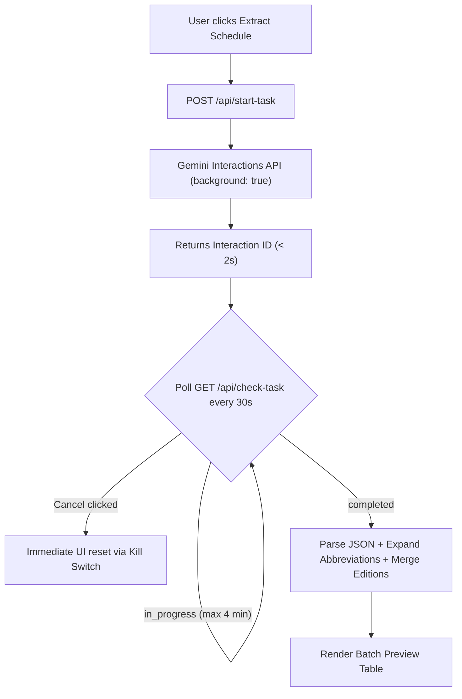

# Release Order (RO) Generator

A client-side web application for generating advertising Release Order PDFs with Google Sheets backend tracking and AI-powered newspaper schedule extraction.

---

## Architecture & Project Structure

| File | Purpose |
| :--- | :--- |
| `index.html` | **Frontend UI & PDF Engine** — Single-page interface. Collects release order details, communicates with the Google Apps Script backend, overlays text onto PDF templates directly in browser via `pdf-lib`, and manages batch AI extraction with 30s polling and cancellation kill switch. |
| `code.gs` | **Backend (Google Apps Script)** — Deployed as a Google Apps Script Web App. Manages financial-year based RO numbering (`YY-YY/XXXX`), atomic batch reservations, appends records to the Google Sheet tracker, and supports fetching/editing existing ROs. |
| `netlify/functions/start-task.mjs` | **Async AI Extraction Trigger** — Initiates a background Gemini Interactions API task (`background: true`, `store: true`) using `@google/genai` and immediately returns the interaction ID in < 2 seconds, avoiding serverless timeout limits. |
| `netlify/functions/check-task.mjs` | **Async AI Status Polling** — Checks ongoing Gemini interaction status via `ai.interactions.get()`. When complete, extracts JSON data, expands routine abbreviations (`दै0`/`दै०` → Daily, `सा0`/`सा०` → Weekly), and merges multi-edition publications. |
| `netlify/functions/config.js` | **Serverless Config Endpoint** — Exposes server-side API key configuration status without leaking the key. |
| `server.js` | **Local Development Server** — Provides full environment parity for local development (`node server.js`), serving static files and implementing matching `/api/start-task`, `/api/check-task`, and `/api/config` routes. |
| `RO_With_Remarks.pdf` | **Template** — Base PDF template with Remarks section. |
| `RO_No_Remarks.pdf` | **Template** — Base PDF template without Remarks section. |
| `Logo.ico` | Application icon / Favicon. |

---

## AI Extraction Architecture (Asynchronous Interactions API)

To eliminate the 26-second Netlify function execution timeout on large schedule PDFs, schedule extraction uses an asynchronous trigger-and-poll architecture:



1. **Trigger Phase (`start-task.mjs`)**: The frontend sends the PDF and schedule text to `/api/start-task`. The function starts a background Gemini interaction and returns an `id` immediately.
2. **Polling Phase (`check-task.mjs`)**: The client counts down and polls `/api/check-task?id=...` every **30 seconds** (capped at **4 minutes** max).
3. **Kill Switch**: A visible **"✕ Cancel Extraction"** button allows users to immediately abort the polling cycle and restore the interface at any time.
4. **Completion & Merging**: When status is `completed`, the function expands periodicity abbreviations (`दै0`/`दै०` → Daily, `सा0`/`सा०` → Weekly), merges rows sharing the same publication name into multi-editions, and returns clean structured rows to populate the batch review table.

---

## Local Development

```bash
# Run local development server
node server.js
```
Then visit `http://localhost:3000`.

---

## Changelog

- **v1.2.0 (Async Interactions API & Netlify Polling)**:
  - Implemented asynchronous Gemini Interactions API with `start-task.mjs` and `check-task.mjs`.
  - Added 30-second polling cadence with live button countdown and 4-minute maximum timeout cap.
  - Added interactive "✕ Cancel Extraction" kill switch.
  - Added explicit abbreviation expansion for `दै0`/`दै०` (Daily) and `सा0`/`सा०` (Weekly).
  - Added full local development parity in `server.js`.
  - Added Netlify security redirect blocking public downloads of `server.js`.
- **v1.1.0**: Batch RO automation, atomic Google Sheets reservation, multi-edition merging.
- **v1.0.0**: Initial Release Order generator with single RO PDF creation and Google Sheets sync.
