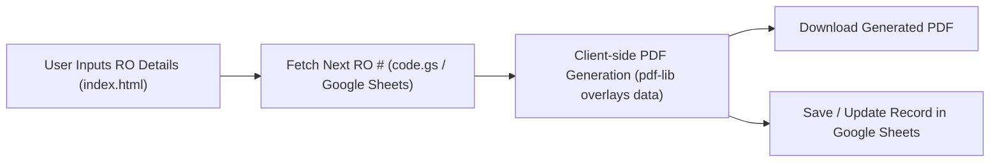

# Release Order (RO) Generator

A client-side web application for generating advertising Release Order PDFs with Google Sheets backend tracking.

---

## Architecture & Project Structure

| File | Purpose |
| :--- | :--- |
| `index.html` | **Frontend UI & PDF Engine** — Single-page interface. Collects release order details, communicates with the Google Apps Script backend, and overlays text onto PDF templates directly in the browser via `pdf-lib`. |
| `code.gs` | **Backend (Google Apps Script)** — Deployed as a Google Apps Script Web App. Manages financial-year based RO numbering (`YY-YY/XXXX`), appends records to the Google Sheet tracker, and supports fetching/editing existing ROs. |
| `RO_With_Remarks.pdf` | **Template** — Base PDF template with Remarks section. |
| `RO_No_Remarks.pdf` | **Template** — Base PDF template without Remarks section. |
| `Logo.ico` | Application icon / Favicon. |

---

## How It Works



1. **Numbering & Tracking**: On load, the frontend requests the next RO number from Google Apps Script (`code.gs`), formatted according to the current Indian Financial Year (starts April 1st).
2. **PDF Generation**: `pdf-lib` fetches the selected PDF template and embeds form data (client, publication, schedule dates, dimensions, rates) with precise coordinates.
3. **Synchronization**: Form submission triggers both a native PDF download and an asynchronous POST request to log the entry in the Google Sheet tracker.

---

## Local Development

Browsers block fetching local PDF files over the `file://` protocol due to CORS security rules. To run locally, serve the directory using any HTTP server:

```bash
# Using Node.js (or any static server)
node server.js
```
Then visit `http://localhost:3000`.

*(Note: Local server scripts are kept in `.git/info/exclude` to keep the repository clean).*

---

## Changelog & Upcoming Changes

- **Base Setup**: Local development setup, repository synchronization, and architecture documentation.
